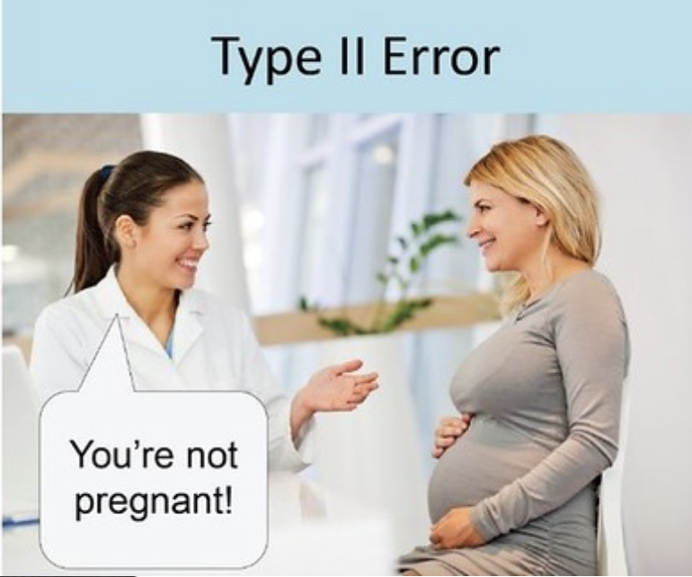
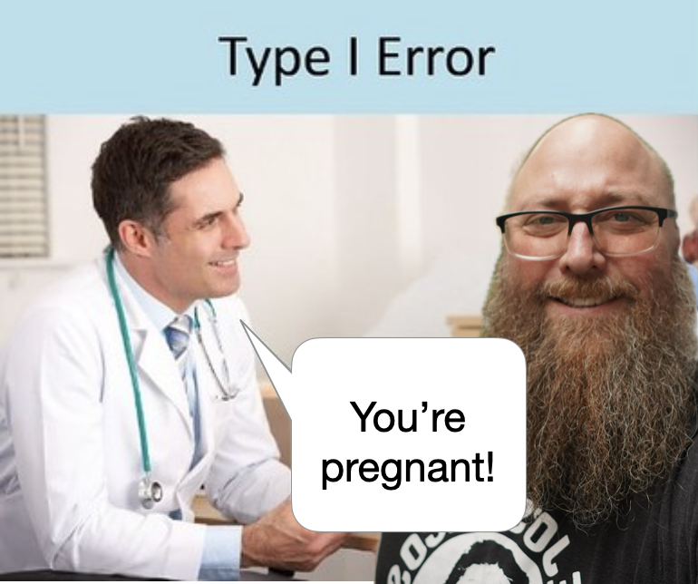

## &nbsp;

```{r}
#| echo: false
#| fig-align: center
source("_extensions/dyerlab/figures_dyerlab.R")
variable_types_grid(highlight = "aov")
```


## Testing for Specific Values

In general, many times we are interested in testing to see if some samples have a particular value.  

Examples may include:

::: {.incremental}
- $H_O: \mu = c$  The mean of the data is equal to a specific value.  

- $H_O: \mu_1 = \mu_2$  These two samples have the same mean.  

- $H_O: \mu_1 = \mu_2 = \mu_3 ... \mu_k$: The mean of all $k$ values are all the same.
:::


## 1-Sample Tests

The 1-sample `t.test()` defined by the null hypothesis:

$H_O: \mu = c$ 

Tests to see if the mean of a set of data is equivallent to a specific value.

::: {.fragment}
The t-statistic is:
$$
t =\frac{\bar{x}-\mu}{s_{\bar{x}}}
$$
:::


## Degrees of Freedom & Rejection Regions

```{r}
#| echo: false
library( tidyverse )
ggplot2::theme_set( theme_minimal() )
x <- seq(-5,5,by=0.02)
d <- data.frame( t=c(x,x,x),
                  f=c(dt(x,df=1),
                      dt(x,df=3),
                      dt(x,df=Inf)),
                  df=rep(c("1","3","Inf"),each=length(x)))

ggplot( d, aes(x=t,y=f,color=df)) + geom_line() 
```


## Asymptotic Nature of Samples {.smaller}

As $df \to \infty$, $PDF(t) \to Normal$. Which is defined (in such elegance) as:

$$
P(t|x,v)= \frac{ \Gamma\left( \frac{v+1}{2}\right)}{\sqrt{v\pi}\Gamma\left( \frac{v}{2}\right)} \left( 1 + \frac{x^2}{v}\right)^{-\frac{v+1}{2}}
$$


where:

- $x$ is the value of the $t$ statistic,
- $v$ is the degrees of freedom ($df = N - 1$ for a one-sample test), and
- $\Gamma$ is the Gamma function, which extends the factorial to non-integers ($\Gamma(n) = (n-1)!$ for whole numbers).


## $H_O: \mu = c$

```{r}
#| echo: false
nu <- 24
d.t <- data.frame( t = x, f = dt( x, df = nu ) )
t_two <- qt( 0.975, df = nu )
t_one <- qt( 0.95, df = nu )
ggplot( d.t, aes(x = t, y = f) ) + 
  geom_area( data = d.t[ d.t$t <= -t_two, ], fill = "#F8766D", alpha = 0.5 ) + 
  geom_area( data = d.t[ d.t$t >=  t_two, ], fill = "#F8766D", alpha = 0.5 ) + 
  geom_line() + 
  annotate( "text", x = c(-3, 3), y = 0.05, label = "2.5%" ) + 
  labs( x = "t", y = "Density",
        caption = sprintf( "df = %d; reject if t < %.3f or t > %.3f", nu, -t_two, t_two ) )
```

Two-tailed: reject $H_O$ if $\bar{x}$ is far from $c$ in *either* direction.


## $H_O: \mu \ge c$

```{r}
#| echo: false
ggplot( d.t, aes(x = t, y = f) ) + 
  geom_area( data = d.t[ d.t$t <= -t_one, ], fill = "#F8766D", alpha = 0.5 ) + 
  geom_line() + 
  annotate( "text", x = -2.9, y = 0.05, label = "5%" ) + 
  labs( x = "t", y = "Density",
        caption = sprintf( "df = %d; reject if t < %.3f", nu, -t_one ) )
```

One-tailed: reject $H_O$ only if $\bar{x}$ is far *below* $c$.


## $H_O: \mu \le c$

```{r}
#| echo: false
ggplot( d.t, aes(x = t, y = f) ) + 
  geom_area( data = d.t[ d.t$t >= t_one, ], fill = "#F8766D", alpha = 0.5 ) + 
  geom_line() + 
  annotate( "text", x = 2.9, y = 0.05, label = "5%" ) + 
  labs( x = "t", y = "Density",
        caption = sprintf( "df = %d; reject if t > %.3f", nu, t_one ) )
```

One-tailed: reject $H_O$ only if $\bar{x}$ is far *above* $c$.


# One Sample Test {background-color="black" background-image="media/contour.png" background-size="initial" background-position="right"}


## The Iris Data (Again) {.smaller}

:::: {.columns}

::: {.column width="50%"}
```{r}
#| echo: false
library( knitr )
iris |>
  group_by( Species ) |>
  summarize( SL.m = mean( Sepal.Length),
             SL.sd = sd( Sepal.Length ) ) |>
  mutate( `Sepal Length` = paste( SL.m, "+/-", format( SL.sd, digits=3) , sep=" " ) ) |>
  mutate( Species = paste( "I.",Species) ) |>
  select( Species, `Sepal Length` ) |>
  rbind(tibble( Species="Average", `Sepal Length` = "5.843")) |>
  kable( digits=3)
```
:::

::: {.column width="50%"}

:::

::::


## Iris setosa Example {.smaller}

$H_O: Iris\;setosa\;Sepal\;Length = 5.843$

:::: {.columns}

::: {.column width="50%"}


```{r}
#| echo: true
iris |>
  filter( Species == "setosa" ) |>
  select( Sepal.Length ) |>
  t.test( mu=5.843 )
```
:::

::: {.column width="50%"}
```{r}
#| echo: false 
ggplot( iris, aes(x=Sepal.Length, fill=Species)) + geom_density(alpha=0.75)
```
:::

::::


## Iris versicolor Example {.smaller}

$H_O: Iris\;versicolor\;Sepal\;Length = 5.843$

:::: {.columns}

::: {.column width="50%"}

```{r}
#| echo: true
iris |>
  filter( Species == "versicolor" ) |>
  select( Sepal.Length ) |>
  t.test( mu=5.843 )
```
:::

::: {.column width="50%"}
```{r}
#| echo: false
ggplot( iris, aes(x=Sepal.Length, fill=Species)) + geom_density(alpha=0.75)
```
:::

::::


## Iris virginica Example {.smaller}

$H_O: Iris\;virginica\;Sepal\;Length = 5.843$

:::: {.columns}

::: {.column width="50%"}


```{r}
#| echo: true
iris |>
  filter( Species == "virginica" ) |>
  select( Sepal.Length ) |>
  t.test( mu=5.843 )
```
:::

::: {.column width="50%"}
```{r}
#| echo: false
ggplot( iris, aes(x=Sepal.Length, fill=Species)) + geom_density(alpha=0.75)
```
:::

::::


## Confidence Intervals.


```{r}
#| echo: true
t <- iris |>
  filter( Species == "virginica" ) |>
  select( Sepal.Length ) |>
  t.test( mu=6 ) 
names(t)
```


:::{.fragment}
The confidence interval itself is defined by the underlying t-distribution as:

$\bar{x} - t_{\alpha, df} s_{\bar{x}} < \mu < \bar{x} + t_{\alpha, df} s_{\bar{x}}$

```{r}
t$conf.int
```
:::


# Two-Sample Tests {background-color="black" background-image="media/contour.png" background-size="initial" background-position="right"}


## Evaluating Equality of 2 Means

:::: {.columns}

::: {.column width="50%"}
### Null Hypothesis

$H_O: \mu_{versicolor} = \mu_{virginica}$

Which is estimated by the statistic.

$t = \frac{\bar{x}_1 - \bar{x}_2}{s_{\bar{x}_1-\bar{x}_2}}$

where $s_{\bar{x}_1-\bar{x}_2}$ is referred to as the *pooled variance* and is defined as:

$s_{\bar{x}_1-\bar{x}_2} = \sqrt{ \frac{s_1^2}{N_1}+\frac{s_2^2}{N}}$

:::

::: {.column width="50%"}
```{r}
#| echo: false 
iris |>
  filter( Species != "setosa" ) |>
  ggplot( aes(Species,Sepal.Length) ) + geom_boxplot(notch=TRUE)
```
:::

::::


## Testing Equality of 2 Means

```{r}
x <- iris |> 
  filter( Species == "versicolor") |> 
  select( Sepal.Length ) 
y <- iris |> 
  filter( Species == "virginica") |> 
  select( Sepal.Length ) 
t.test( x, y )
```

## Paired t-tests

If the data are collected in a way that there is supposed to be a *connection* between the values of `x` and `y` (e.g., looking at fluctuating asymmetry in wing shape in individual birds where left wing = right wing), you could instead treat the two data as:

$H_O: \mu_{x} -  \mu_{y} = 0.0$

and can be evaluated as:

```{r eval=FALSE}
t.test(x, y, paired = TRUE)
```


:::{.fragment}
These data are not `paired` so I will not provide an example.  The key here is that the data must come from a biologically and/or ecologically relevant pairing.
:::


# Equality of Many Means {background-color="black" background-image="media/contour.png" background-size="initial" background-position="right"}


## Errors Around $H_O: Not\;Pregnant$ {.smaller}


:::: {.columns}

::: {.column width="45%"}

:::

::: {.column width="45%"}
&nbsp;

Non-rejection of a false null hypothesis:

- `false negative`
:::

::::


## Errors Around $H_O: Not\;Pregnant$ {.smaller}

:::: {.columns}
::: {.column width="45%"}
&nbsp;

Rejecting of a true null hypothesis:  

- `false positive`
:::

::: {.column width="45%"}
 
:::

::::


## Multiple Testing Problem

The rejection region as $\alpha$ is defined as the fraction of the underlying distribution that we will consider as rare enough to reject $H_O$.  

&nbsp;

The probability of rejecting $H_O$ incorrectly is $\alpha$ and the probability of not rejecting $H_O$ incorrectly is $1-\alpha$.  


## Multiple Testing Problem

> What is the probability of getting at least one false positive result if we test all three pairs of individual mean values in the Iris data set?

:::{.fragment}

$P(false\;positive) = 1 - P(no\;significant\;results)$ 

for each trial.  So, if we are to do 3 tests, this is equal to 

$1 - (1-0.05)^3 \approx 0.1426$
:::

## Multiple Testing Problem

If we test all three pairs of tests for the *Iris* data, we are expecting, 

&nbsp;

<font color="red">even if there are absolutely **no differences** between species,</font> 

&nbsp;

we **expect** to reject the $H_O$ at least 14% of the time!


:::{.fragment}
&nbsp;

**Change either $\alpha$ (known as a Bonferroni Correction) or adjust the Model itself (preferred).**
:::


## A Linear Model Approach 

```{r}
#| echo: false
ggplot( iris, aes(x=Species, y=Sepal.Length)) + 
  geom_jitter( width=0.25) +
  ylab("Sepal Length") 
```

$y_{ij} = \mu + \tau_i + \epsilon_{ij}$


## A Linear Model Approach 

```{r}
#| echo: false
ggplot( iris, aes(x=Species, y=Sepal.Length)) + 
  stat_summary( color="#0F8B8D", size=1.2 ) +
  geom_jitter( width=0.25) +
  ylab("Sepal Length") 
```

$y_{ij} = \mu + \tau_i + \epsilon_{ij}$


## A Linear Model Approach 

```{r}
#| echo: false
ggplot( iris, aes(x=Species, y=Sepal.Length)) + 
  geom_boxplot(notch = TRUE, color="#cc8011") + 
  geom_abline( aes(intercept=mean(iris$Sepal.Length),slope=0), col = "red", lty=2 ) +
  stat_summary( color="#0F8B8D", size=1.2 ) +
  geom_jitter( width=0.25) +
  ylab("Sepal Length") 
```

$y_{ij} = \mu + \tau_i + \epsilon_{ij}$


## A Linear Model Approach {.scrollable}


$y_{ij} = \mu + \tau_i + \epsilon_{ij}$

where:   

- $\mu$ is the overall mean of all the data.  
- $\tau_i$ is the deviation of the $i^{th}$ treatment level from the overall mean.  
- $\epsilon_{ij}$ is the deviation of the $j^{th}$ observation from the mean of treatment $i$.


:::{.fragment}
*The Null Hypothesis*
$H_O: \tau_i = 0$
:::


## Decomposing the Variance

The Analysis of Variance Table for Testing the Null Hypothesis $H_O: \tau_i = 0$.

&nbsp;

Source  | df    | SS                                                                 | MS
----|---|----------------------------------------------------------------|------------------------------------------------
Among   | $K-1$ | $\sum_{i=1}^K N_i \left( \bar{x}_i - \bar{x} \right)^2$            | $\frac{SS_A}{K-1}$
Within  | $N-K$ | $\sum_{i=1}^K \left( \sum_{j=1}^{N_i}(x_{ij}-\bar{x}_i)^2 \right)$ | $\frac{SS_W}{N-K}$
Total   | $N-1$ | $\sum_{i=1}^K \sum_{j=1}^{N_i} (x_{ij} - \bar{x})^2$               | 


## The Test Statistic

Which is evaluated by the statistic:

$F = \frac{MS_A}{MS_W}$

::: {.fragment}
defined by the most excellent $F$ distribution.
&nbsp;
$f(x | df_A, df_W) = \frac{\sqrt{\frac{(df_Ax)^{df_A}df_W^{df_W}}{(df_Ax + df_W)^{df_W+df_A}}}}{x\mathbf{B}\left( \frac{df_A}{2}, \frac{df_W}{2} \right)}$
:::


## Analysis of Variance (aov)

In `R` we use the `aov()` function.

```{r}
fit.aov <- aov( Sepal.Length ~ Species, data=iris)
fit.aov
```

## Analysis of Variance Table

The variance decomposition for this model, just like for regression models, can be displayed using the `anova()` summary function.

```{r}
anova( fit.aov )
```


# Post-Hoc Testing {background-color="black" background-image="media/contour.png" background-size="initial" background-position="right"}


## Why Post-Hoc?

Potential Outcomes where $H_O$ is rejected:

- $\mu_{setosa} \; \ne \mu_{virginica}$

- $\mu_{setosa} \; \ne \mu_{versicolor}$

- $\mu_{virginica} \; \ne \mu_{versicolor}$

- $\mu_{setosa} \; \ne \; \mu_{virginica} \; \ne \mu_{versicolor}$


:::{.fragment}
By rejecting $H_O$, we do not know <font color="red">which of the previous statements</font> caused the Among-Treatment Sums of Squares to be large enough to push the estimate of $F$ into the rejection region of the distribution.
:::


## The Tukey Test

This test examines all pairs of means and determines if their confidence intervals overlap or not.

```{r}
tuk <- TukeyHSD(fit.aov)
tuk
```


## The Tukey Test

The difference is: 

$q = \frac{\bar{y}_{max} - \bar{y}_{min}}{\sqrt{MS_W / n}}$

where $n$ is the number of observations in each group,
and the confidence intervals are based upon the Studentized range distribution.


## Visualizing the Tukey

```{r fig.height= 5.5}
plot( tuk, xlim=c(-1,2) )
```


# Two-Factor Models {background-color="black" background-image="media/contour.png" background-size="initial" background-position="right"}


## Analysis with 2 Predictors.

There are times when we have more than one treatment category for a response.  For example, a growth experiment may have a treatment that is high light and low light as well as one that has fewer than normal, normal, and more than normal nutrients.  These are called *2-factor Analysis of Variance*.

- Each factor can be considered independently.
- The interaction between factors can be examined as well.

## Specifying A Two Factor Model

Here I'm going to use a new data set because there is only one categorical variable in the *iris* data used above.  Here is the old *Motor Trend Cars* dataset

```{r}
df <- mtcars
summary( df )
```

## Speed ~ Engine Type & Transmission

I'm renaming here for brevity in the plot labels.


```{r}
df |> 
  mutate( Engine = factor( ifelse( vs == 0, "V", "Straight") ),
          Transmission = factor( ifelse( am == 0, "Auto","Manual")) ) |>
  select( Time = qsec, Engine, Transmission) -> df 
summary( df )
```

## One Factor Analyses: Engine


```{r}
fit.engine <- aov( Time ~ Engine, data=df )
anova(fit.engine)
```

## One Factor Analyses: Transmission


```{r}
fit.transmission <- aov( Time ~ Transmission, data=df )
anova( fit.transmission )
```


## Interaction Terms

This notation inserts both terms independently **and** their interaction into the model.

```{r}
fit.both <- aov( Time ~ Engine*Transmission, data=df )
anova( fit.both )
```

## &nbsp;

```{r}
plot( TukeyHSD( fit.both, "Engine"))
```

## &nbsp;

```{r}
plot( TukeyHSD( fit.both, "Transmission"))
```

## &nbsp;

```{r}
par( mar = c(4, 13, 2, 1), las = 1 )  # wide left margin, horizontal labels
plot( TukeyHSD( fit.both, "Engine:Transmission"))
```


## Questions

::: {layout-ncol="2"}
If you have any questions, please feel free to either post them as an "Issue" on your copy of this GitHub Repository, post to the [Canvas](https://canvas.vcu.edu) discussion board for the class, or drop me an [email](mailto://rjdyer@vcu.edu).

{.middle fig-alt="Peter Sellers looking bored" fig-align="center" width="500"}
:::
